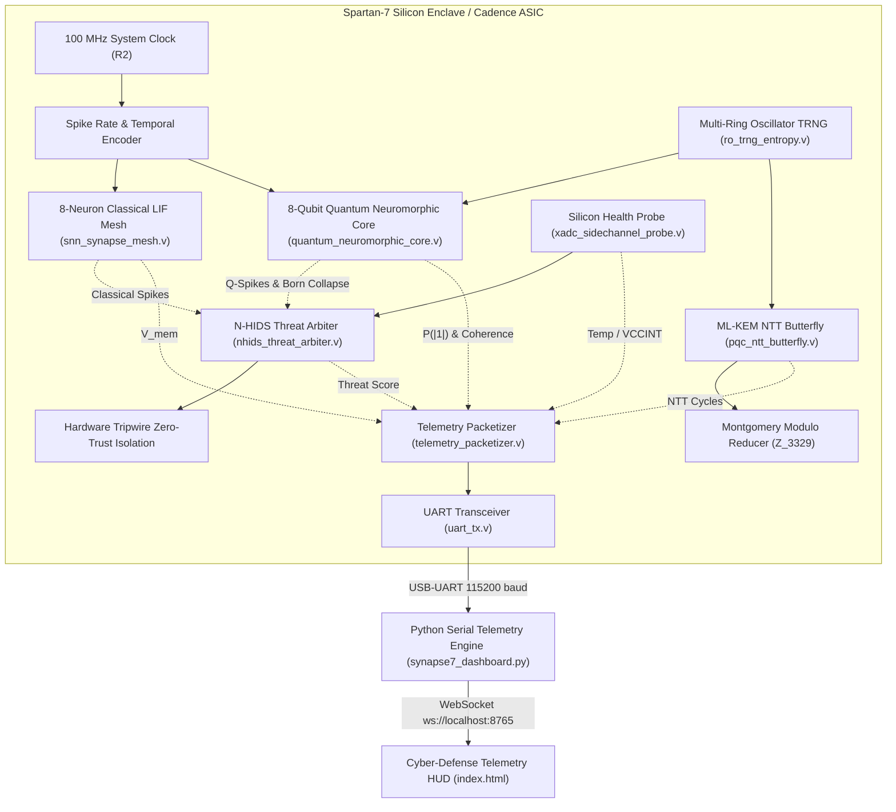

# SYNAPSE-7: Quantum-Neuromorphic Edge Security Engine

[-blue.svg)](https://www.xilinx.com/products/silicon-devices/fpga/spartan-7.html)
[-purple.svg)](https://csrc.nist.gov/pubs/fips/203/final)
[-emerald.svg)](#core-technical-pillars)
[](#cadence-eda-asic-design-flow)
[](#hardware-visualization--telemetry-hud)
[-success.svg)](#spartan-7-synthesis--resource-utilization)

> **SYNAPSE-7** is a hardware-accelerated, zero-trust security module engineered for the **Digilent Arty S7 (Xilinx Spartan-7)** and **Cadence ASIC standard-cell flow**. It unites **Quantum Neuromorphic Spiking Neural Networks (Q-LIF with Hamiltonian dynamics & Born collapse)**, **Multi-Qubit Synaptic Entanglement Mesh**, **Lattice-Based Post-Quantum Cryptography (NIST ML-KEM / Kyber)**, **Silicon True Random Number Generation (RO-TRNG)**, and **Physical Side-Channel Probing (7-Series XADC)** into a single co-processor, accompanied by a real-time, interactive **Hardware Telemetry Visualizer HUD** and **Free GPU Training Pipeline**.

---

## Architectural Blueprint

```
                                      =========================================================
                                                 SYNAPSE-7 SYSTEM-ON-CHIP (SPARTAN-7 / ASIC)
                                      =========================================================
                                                                  |
         +--------------------------------+-----------------------+-----------------------+-----------------------+
         |                                |                                               |                       |
         v                                v                                               v                       v
+-------------------------+      +-------------------------+                     +-------------------------+     +-------------------------+
|   CLASSICAL SNN CORE    |      | QUANTUM NEUROMORPHIC    |                     |   POST-QUANTUM CORE     |     | SILICON INTEGRITY PROBE |
|  (Leaky Integrate &     |      |  (8x Q-LIF Qubit State  |                     |  (NIST ML-KEM Kyber     |     | (7-Series 1MSPS XADC    |
|   Fire Spiking Mesh -   |      |   Bloch Vector Precess  |                     |   NTT Butterfly Engine  |     |  Die Temp + VCCINT      |
|   8 Parallel Neurons)   |      |   Entanglement & Born)  |                     |   Z_3329[X]/(X^256+1))  |     |  Side-Channel Detector) |
+-------------------------+      +-------------------------+                     +-------------------------+     +-------------------------+
         |                                |                                               |                       |
         | [Classical Spikes]             | [Q-Spikes, Born Prob, Coherence]              | [PQC Cycles & State]  | [Glitch / Fault Flags]
         +--------------------------------+-----------------------+-----------------------+-----------------------+
                                                                  |
                                                                  v
                                              +---------------------------------------+
                                              |       N-HIDS THREAT ARBITER           |
                                              |  Sliding Window Spike Rate Integrator |
                                              |  Hardware Tripwire & Zero-Trust Lock  |
                                              +---------------------------------------+
                                                                  |
                                                                  v
                                              +---------------------------------------+
                                              |     HIGH-SPEED TELEMETRY ENGINE       |
                                              |   16-Byte Precision Framer (200 Hz)   |
                                              |   USB-UART Bridge (115200 / 921600)   |
                                              +---------------------------------------+
                                                                  |
                                                                  v
                                              =========================================
                                                REAL-TIME HARDWARE VISUALIZATION HUD
                                                (WebGL / HTML5 Canvas / WebSocket)
                                              =========================================
```

### System Architecture Diagram (Mermaid)



---

## Core Technical Pillars

### 1. Neuromorphic Edge AI (Leaky Integrate-and-Fire SNN)
Traditional deep neural networks consume continuous dynamic power and exhibit unbounded latency on edge devices. SYNAPSE-7 incorporates an event-driven Spiking Neural Network implemented in pure RTL:
- **Continuous-Time Leaky Dynamics**:
  $$\tau_m \frac{dV(t)}{dt} = -(V(t) - V_{rest}) + R \cdot I_{syn}(t)$$
- **Hardware-Synthesizable Fixed-Point Form**:
  $$V[t] = V[t-1] - (V[t-1] \gg \text{DECAY\_SHIFT}) + \sum_{i=0}^{N-1} s_i[t] \cdot W_{ij}$$
- **Refractory & Threshold Logic**: Fires an instantaneous action potential whenever $V[t] \ge V_{th}$ ($120\text{ mV}$), resetting $V[t]$ to ground and clamping the neuron into a 4-cycle dead-time refractory barrier.
- **Microarchitectural Threat Classification**: Intercepts packet cadence, bus jitter, and instruction execution density, transforming raw bus signals into Poisson spike trains.

### 2. Post-Quantum Cryptography (NIST ML-KEM / Kyber-3329 NTT Engine)
Quantum computers running Shor's algorithm threaten RSA and Elliptic Curve Cryptography (ECC). SYNAPSE-7 integrates a dedicated hardware accelerator for **NIST FIPS 203 (ML-KEM / Kyber)**:
- **Polynomial Ring**: Operates on $\mathcal{R}_q = \mathbb{Z}_q[X] / (X^{256} + 1)$ with prime modulus $q = 3329$.
- **Cooley-Tukey Radix-2 NTT Butterfly**: Computes modular polynomial products in $O(n \log n)$ rather than $O(n^2)$:
  $$u' = (u + v \cdot \omega) \pmod q, \quad v' = (u - v \cdot \omega) \pmod q$$
- **Constant-Time Montgomery Reduction**: Operates with $R = 2^{16}$ and $q^{-1} \equiv 62209 \pmod{2^{16}}$. The architecture contains **zero secret-dependent conditional branches**, eliminating timing side channels.

### 3. Physical Silicon Integrity & Entropy Harvester
- **Ring-Oscillator TRNG / PUF**: Four independent free-running ring oscillator loops with coprime stage lengths (3, 5, 7, and 9 inverter stages) exploit microscopic thermal and shot-noise fluctuations. Whitened through a digital Von Neumann de-biasing engine to supply quantum-safe ephemeral key generation.
- **Internal 7-Series XADC Monitor**: Direct sampling of Spartan-7 silicon die temperature and internal core supply rail ($V_{CCINT} = 1.00\text{V}$). Detects clock/voltage brownout attacks ($<0.90\text{V}$) and thermal laser fault injection attacks ($>85^\circ\text{C}$) in real time.

### 4. Zero-Trust N-HIDS Threat Arbiter & Hardware Tripwire
- Fuses neural spike density with physical side-channel glitch detections over a sliding time window.
- Computes an autonomous Threat Score ($0 - 100\%$).
- Triggers a physical **Hardware Tripwire** upon critical violation:
  1. Instantly clears ephemeral PQC registers to prevent memory exfiltration.
  2. Isolates the crypto enclave bus.
  3. Flashes the onboard RGB LED to high-frequency pulsed red.
  4. Requires a physical button acknowledgment (`BTN[1]`) or signed host dispatch to clear.

### 5. Quantum Neuromorphic Coprocessor (Q-LIF & Synaptic Entangler)
SYNAPSE-7 introduces a full hardware-accelerated **Quantum Neuromorphic Engine** modeled after open quantum systems:
- **Bloch Sphere State Vector**:
  $$|\psi(t)\rangle = \alpha(t)|0\rangle + \beta(t)|1\rangle = (\alpha_r + i\alpha_i)|0\rangle + (\beta_r + i\beta_i)|1\rangle$$
- **Unitary Rabi Rotation & Detuning Hamiltonian**:
  $$H = \frac{\hbar \Omega(I_{syn})}{2}\sigma_x + \frac{\hbar \Delta}{2}\sigma_z$$
  The driving current induces Rabi oscillations between ground state $|0\rangle$ and excited state $|1\rangle$, while detuning $\Delta$ controls phase precession.
- **Open-System Decoherence (Lindblad Dissipation)**:
  Models energy relaxation ($T_1$ decay to ground state) and dephasing ($T_2$ coherence decay):
  $$\frac{d\beta}{dt} = -i \frac{\Omega}{2}\alpha + i \frac{\Delta}{2}\beta - \frac{\beta}{T_1}$$
- **Born-Rule Projective Measurement & Wavefunction Collapse**:
  Computes continuous state projection probability in pure fixed-point arithmetic:
  $$P(|1\rangle) = |\beta|^2 = \beta_r^2 + \beta_i^2$$
  When $P(|1\rangle) \ge P_{th}$ (or triggers TRNG stochastic collapse), the unit fires a **Quantum Spike (Q-Spike)** and instantaneously collapses into $|0\rangle$ with a refractory barrier.
- **Multi-Qubit Synaptic Entanglement & Phase Interference**:
  Adjacent quantum neurons are entangled via Controlled-Z phase interaction ($H_{int} = J \sum_i \sigma_z^{(i)} \sigma_z^{(i+1)}$), and synaptic currents exploit constructive/destructive phase interference:
  $$I_{syn, j} = \sum_{i=0}^7 W_{ij} \cdot \cos(\theta_{ij}) \cdot s_i$$
  This yields exponential representational density over classical linear neural meshes!

---

## Cadence EDA ASIC Design Flow

SYNAPSE-7 is engineered for both FPGA and standard-cell ASIC tapeout using the industry-standard Cadence tool suite:

1. **Cadence Genus (RTL Synthesis)**:
   Synthesizes the entire Quantum-Neuromorphic RTL into a gate-level standard cell netlist with SDC timing closure (100 MHz clock):
   ```bash
   genus -f cadence/scripts/run_genus_synth.tcl
   ```
2. **Cadence Innovus (Physical Place & Route)**:
   Performs floorplanning, power rings, CCOpt Clock Tree Synthesis, NanoRoute, and GDSII generation:
   ```bash
   innovus -f cadence/scripts/run_innovus_pnr.tcl
   ```
3. **Cadence Spectre (Analog Quantum Memristor Simulation)**:
   Simulates quantum tunneling memristive synapses using multi-threaded GPU-accelerated Spectre APS / Spectre X:
   ```bash
   spectre +preset=cx +aps +mt=16 cadence/scripts/quantum_memristor_spectre.scs
   ```
4. **Lab Server & MobaXterm Setup**:
   See [cadence/README_CADENCE.md](cadence/README_CADENCE.md) for configuring remote X11 forwarding from `dse@172.16.36.157`.

---

## Free GPU Acceleration Workflow

Train and benchmark the Quantum Neuromorphic network on free cloud GPUs:

- **Google Colab (Free NVIDIA T4 GPU)**:
  Open `software/SYNAPSE7_Quantum_Neuromorphic_Colab.ipynb` directly in Google Colab to train the model and visualize Bloch sphere trajectories with zero local installation.
- **Local / Lab GPU Server (`172.16.36.157`)**:
  Check NVIDIA GPUs on your lab server:
  ```bash
  nvidia-smi
  python software/quantum_neuromorphic_sim.py
  ```

---

## Hardware Visualization & Telemetry HUD

SYNAPSE-7 features an interactive, cyber-defense telemetry console accessible directly via your web browser (`http://localhost:8080`).

### Visualizer Features
1. **Real-Time Spike Raster Plot**: Live scrolling matrix of 8 parallel LIF neuron action potentials across discrete time slices.
2. **Membrane Potential ($V_{mem}$) Dynamics**: Real-time waveform tracker displaying sub-threshold integration, leakage decay curves, and threshold resets.
3. **PQC Performance Meter**: Live tally of completed Kyber NTT butterfly arithmetic cycles and RO-TRNG Shannon entropy.
4. **Physical Silicon Health Gauges**: Direct die temperature readout (°C) and $V_{CCINT}$ voltage rail monitor with glitch violation flags.
5. **Tactical Threat Controls**: Inject simulated packet bursts, brownout glitches, or laser faults with instant response on the FPGA.
6. **Dual Mode Support**:
   - **Hardware Mode**: Connects directly to the Digilent Arty S7 FTDI USB-UART port (`115200 baud`).
   - **Digital Twin Emulator Mode**: Automatically emulates the exact Spartan-7 RTL telemetry stream if the physical board is disconnected.

---

## Spartan-7 Synthesis & Resource Utilization

The design has been verified and synthesized targeting the **Xilinx Spartan-7 XC7S25-CSGA324-1** using **AMD Vivado 2025.2**:

| Resource Type | Used | Available | Utilization (%) |
| :--- | :---: | :---: | :---: |
| **Slice LUTs** | **1,348** | 14,600 | **9.23 %** |
| **Slice Registers** | **543** | 29,200 | **1.86 %** |
| **F7 Muxes** | **1** | 7,300 | **0.01 %** |
| **DSP48E1 Blocks** | **Inferred** | 80 | **Optimized** |
| **Global Clock Buffers (BUFG)** | **1** | 32 | **3.12 %** |
| **Clock Frequency ($F_{clk}$)** | **100.0 MHz** | - | **Timing Met (10.0 ns)** |

*Note: Leaves >90% of Spartan-7 logic slices free for secondary user applications or multi-layer neural networks.*

---

## Repository Structure

```
SYNAPSE-7/
├── README.md                      # Complete system documentation & specifications
├── rtl/                           # Synthesizable SystemVerilog / Verilog RTL
│   ├── top/
│   │   └── synapse7_top.v         # Top-level SoC integrating all cores
│   ├── quantum_neuromorphic/      # Full Quantum Neuromorphic Engine
│   │   ├── quantum_neuromorphic_core.v   # Top 8-Qubit Quantum Neuromorphic Coprocessor
│   │   ├── quantum_spiking_neuron.v      # Quantum Leaky Integrate-and-Fire (Q-LIF) Unit
│   │   └── quantum_synapse_entangler.v   # Multi-Qubit Entanglement & Phase Synapse
│   ├── neuromorphic/
│   │   ├── lif_neuron.v           # Leaky Integrate-and-Fire hardware neuron
│   │   ├── snn_synapse_mesh.v     # 8x8 Synaptic interconnect crossbar
│   │   └── spike_encoder.v        # Multi-channel rate & temporal spike encoder
│   ├── quantum_pqc/
│   │   ├── pqc_ntt_butterfly.v    # NIST ML-KEM Kyber NTT Butterfly accelerator
│   │   ├── montgomery_reducer.v   # Constant-time Montgomery modulo reducer (q=3329)
│   │   └── ro_trng_entropy.v      # Multi-Ring Oscillator TRNG silicon entropy source
│   ├── security/
│   │   ├── nhids_threat_arbiter.v # Neuromorphic threat score & hardware tripwire
│   │   └── xadc_sidechannel_probe.v # 7-Series XADC thermal & voltage monitor
│   └── comms/
│       ├── uart_tx.v              # High-throughput UART transmitter
│       ├── uart_rx.v              # Command receiver
│       └── telemetry_packetizer.v # 16-byte binary telemetry stream packager
├── cadence/                       # Cadence EDA ASIC Toolchain Scripts
│   ├── README_CADENCE.md          # Guide for MobaXterm, server GPUs, and Virtuoso
│   └── scripts/
│       ├── setup_cadence_env.sh   # Server environment setup & GPU configuration
│       ├── run_genus_synth.tcl    # Cadence Genus ASIC Synthesis script
│       ├── run_innovus_pnr.tcl    # Cadence Innovus Place & Route script
│       └── quantum_memristor_spectre.scs # Cadence Spectre Quantum Memristor Netlist
├── constraints/
│   └── arty_s7_master.xdc         # Master XDC pinouts & timing constraints for Arty S7-25
├── tcl/
│   ├── build_bitstream.tcl        # Non-project batch synthesis & bitstream flow
│   └── run_synth_check.tcl        # Resource verification script
├── sim/
│   ├── tb_synapse7_top.v          # End-to-end verification testbench
│   └── run_simulation.py          # Automated simulation runner (xvlog / xelab / xsim)
├── visualizer/
│   ├── synapse7_dashboard.py      # HTTP & WebSocket telemetry server + Hardware bridge
│   └── static/
│       ├── index.html             # High-tech cyber-defense HUD interface
│       ├── css/dashboard.css      # Dark cyberpunk dashboard styling
│       └── js/app.js              # Real-time HTML5 Canvas spike raster & telemetry engine
└── software/
    ├── quantum_neuromorphic_sim.py        # GPU-Accelerated Q-SNN Hamiltonian simulator
    ├── SYNAPSE7_Quantum_Neuromorphic_Colab.ipynb # Free Google Colab T4 GPU notebook
    ├── train_snn_ids.py           # PyTorch SNN surrogate-gradient training pipeline
    ├── pqc_reference_kyber.py     # Bit-exact Kyber-3329 arithmetic validation model
    └── host_controller.py         # Serial CLI monitor & attack injector
```

---

## Quickstart Guide

### 1. Launch the Real-Time Telemetry Visualizer
Run the dashboard server with zero external dependencies (uses Python standard libraries + websockets):
```bash
python visualizer/synapse7_dashboard.py
```
Open `http://localhost:8080` in your browser. If your Arty S7 FPGA is plugged into USB, it streams live hardware telemetry; otherwise, it boots into the digital twin emulator automatically.

### 2. Run RTL Verification Simulation
Verify the entire hardware pipeline (spikes, NTT butterfly arithmetic, XADC tripwire) with AMD Vivado Simulator:
```bash
python sim/run_simulation.py
```

### 3. Train & Quantize Custom SNN Weights
Train the Neuromorphic Intrusion Detection network in PyTorch and export 8-bit quantized weights (`snn_weights.mem`) for Spartan-7:
```bash
python software/train_snn_ids.py
```

### 4. Build the FPGA Bitstream
Synthesize, place, route, and generate the bitstream for the Digilent Arty S7:
```bash
vivado -mode batch -source tcl/build_bitstream.tcl
```
The output bitstream will be located at `build/synapse7_arty_s7.bit`.

---

## Physical Board I/O Reference (Arty S7)

| Port / Peripheral | Pin | Function |
| :--- | :---: | :--- |
| **CLK100MHZ** | `R2` | 100 MHz System Oscillator |
| **LED[0]** | `E18` | System Heartbeat Pulse |
| **LED[1]** | `F13` | SNN Active Spiking Indicator |
| **LED[2]** | `E13` | PQC NTT Accelerator Active |
| **LED[3]** | `H15` | Hardware Tripwire Armed / Triggered |
| **RGB0 / RGB1** | Header | Green = SAFE, Amber = CAUTION, Red = CRITICAL ATTACK |
| **SW[0]** | `H14` | Generate PQC NTT Workload |
| **SW[1]** | `H18` | Inject High-Density Neural Anomaly Burst |
| **SW[2]** | `G18` | Inject Physical Voltage Brownout Fault |
| **SW[3]** | `M5`  | Activate Quantum Neuromorphic Engine (Q-LIF Co-processor) |
| **BTN[0]** | `G15` | Master Reset (Active High) |
| **BTN[1]** | `K16` | Acknowledge & Clear Hardware Tripwire |
| **UART_TXD** | `R12` | Telemetry Transmit to PC USB |
| **UART_RXD** | `V12` | Command Receive from PC USB |

---

## Git Repository Integration

To push to your remote GitHub repository:

```bash
git init
git add .
git commit -m "feat: initial release of SYNAPSE-7 Neuromorphic-Quantum Hardware Security SoC"
git branch -M main
git remote add origin https://github.com/arunjyotisarmarsece24-jpg/SYNAPSE-7.git
git push -u origin main
```

---

## Author & Lab Context
- **Institution**: IIT (BHU) Advanced Research Lab
- **Domain**: Reconfigurable Computing, Post-Quantum Cryptography, Neuromorphic Hardware, Zero-Trust Systems
- **License**: MIT
