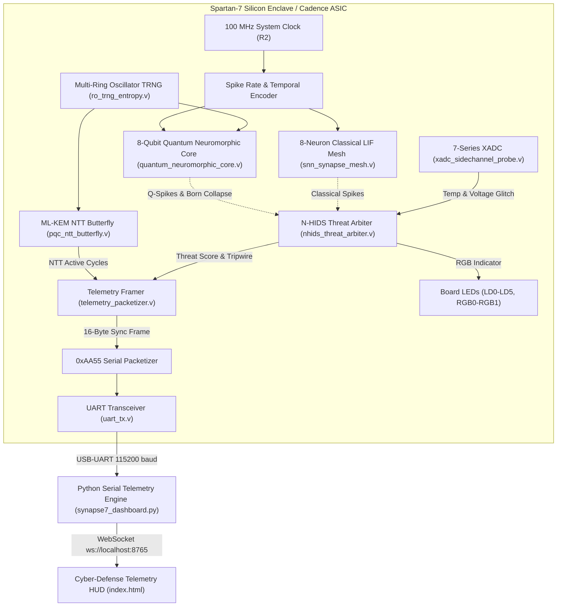

# SYNAPSE-7: Quantum-Neuromorphic Computing & Post-Quantum Hardware Security

[-blue.svg)](https://www.xilinx.com/products/silicon-devices/fpga/spartan-7.html)
[-purple.svg)](https://csrc.nist.gov/pubs/fips/203/final)
[-emerald.svg)](#core-technical-pillars)
[](#cadence-eda-asic-design-flow)
[](#hardware-visualization--telemetry-hud)
[-success.svg)](#spartan-7-synthesis--resource-utilization)

> **SYNAPSE-7** is a hardware-accelerated, zero-trust security module engineered for the **Digilent Arty S7 (Xilinx Spartan-7)** and **Cadence ASIC standard-cell flow**. It unites **Quantum Neuromorphic Spiking Neural Networks (Q-LIF with Hamiltonian dynamics & Born collapse)**, **Multi-Qubit Synaptic Entanglement Mesh**, **Lattice-Based Post-Quantum Cryptography (NIST ML-KEM / Kyber)**, **Silicon True Random Number Generation (RO-TRNG)**, and **Physical Side-Channel Probing (7-Series XADC)** into a single co-processor, accompanied by a real-time, interactive **Hardware Telemetry Visualizer HUD** and **Free GPU Training Pipeline**.

---

## Architectural Blueprint

```
                                      =========================================================
                                                 SYNAPSE-7 SYSTEM-ON-CHIP (SPARTAN-7 / ASIC)
                                      =========================================================
                                                                  |
         +--------------------------------+-----------------------+-----------------------+-----------------------+
         |                                |                                               |                       |
         v                                v                                               v                       v
+-------------------------+      +-------------------------+                     +-------------------------+     +-------------------------+
|   CLASSICAL SNN CORE    |      | QUANTUM NEUROMORPHIC    |                     |   POST-QUANTUM CORE     |     | SILICON INTEGRITY PROBE |
|  (Leaky Integrate &     |      |  (8x Q-LIF Qubit State  |                     |  (NIST ML-KEM Kyber     |     | (7-Series 1MSPS XADC    |
|   Fire Spiking Mesh -   |      |   Bloch Vector Precess  |                     |   NTT Butterfly Engine  |     |  Die Temp + VCCINT      |
|   8 Parallel Neurons)   |      |   Entanglement & Born)  |                     |   Z_3329[X]/(X^256+1))  |     |  Side-Channel Detector) |
+-------------------------+      +-------------------------+                     +-------------------------+     +-------------------------+
         |                                |                                               |                       |
         | [Classical Spikes]             | [Q-Spikes, Born Prob, Coherence]              | [PQC Cycles & State]  | [Glitch / Fault Flags]
         +--------------------------------+-----------------------+-----------------------+-----------------------+
                                                                  |
                                                                  v
                                              +---------------------------------------+
                                              |       N-HIDS THREAT ARBITER           |
                                              |  Sliding Window Spike Rate Integrator |
                                              |  Hardware Tripwire & Zero-Trust Lock  |
                                              +---------------------------------------+
                                                                  |
                                                                  v
                                              +---------------------------------------+
                                              |     HIGH-SPEED TELEMETRY ENGINE       |
                                              |   16-Byte Precision Framer (200 Hz)   |
                                              |   USB-UART Bridge (115200 / 921600)   |
                                              +---------------------------------------+
                                                                  |
                                                                  v
                                              =========================================
                                                REAL-TIME HARDWARE VISUALIZATION HUD
                                                (WebGL / HTML5 Canvas / WebSocket)
                                              =========================================
```

### System Architecture Diagram (Mermaid)



---

## Core Technical Pillars

### 1. Neuromorphic Edge AI (Leaky Integrate-and-Fire SNN)
Traditional deep neural networks consume continuous dynamic power and exhibit unbounded latency on edge devices. SYNAPSE-7 incorporates an event-driven Spiking Neural Network implemented in pure RTL:
- **Continuous-Time Leaky Dynamics**:
  $$\tau_m \frac{dV(t)}{dt} = -(V(t) - V_{rest}) + R \cdot I_{syn}(t)$$
- **Hardware-Synthesizable Fixed-Point Form**:
  $$V[t] = V[t-1] - (V[t-1] \gg \text{DECAY\_SHIFT}) + \sum_{i=0}^{N-1} s_i[t] \cdot W_{ij}$$
- **Refractory & Threshold Logic**: Fires an instantaneous action potential whenever $V[t] \ge V_{th}$ ($120\text{ mV}$), resetting $V[t]$ to ground and clamping the neuron into a 4-cycle dead-time refractory barrier.
- **Microarchitectural Threat Classification**: Intercepts packet cadence, bus jitter, and instruction execution density, transforming raw bus signals into Poisson spike trains.

### 2. Post-Quantum Cryptography (NIST ML-KEM / Kyber-3329 NTT Engine)
Quantum computers running Shor's algorithm threaten RSA and Elliptic Curve Cryptography (ECC). SYNAPSE-7 integrates a dedicated hardware accelerator for **NIST FIPS 203 (ML-KEM / Kyber)**:
- **Polynomial Ring**: Operates on $\mathcal{R}_q = \mathbb{Z}_q[X] / (X^{256} + 1)$ with prime modulus $q = 3329$.
- **Cooley-Tukey Radix-2 NTT Butterfly**: Computes modular polynomial products in $O(n \log n)$ rather than $O(n^2)$:
  $$u' = (u + v \cdot \omega) \pmod q, \quad v' = (u - v \cdot \omega) \pmod q$$
- **Constant-Time Montgomery Reduction**: Operates with $R = 2^{16}$ and $q^{-1} \equiv 62209 \pmod{2^{16}}$. The architecture contains **zero secret-dependent conditional branches**, eliminating timing side channels.

### 3. Physical Silicon Integrity & Entropy Harvester
- **Ring-Oscillator TRNG / PUF**: Four independent free-running ring oscillator loops with coprime stage lengths (3, 5, 7, and 9 inverter stages) exploit microscopic thermal and shot-noise fluctuations. Whitened through a digital Von Neumann de-biasing engine to supply quantum-safe ephemeral key generation.
- **Internal 7-Series XADC Monitor**: Direct sampling of Spartan-7 silicon die temperature and internal core supply rail ($V_{CCINT} = 1.00\text{V}$). Detects clock/voltage brownout attacks ($<0.90\text{V}$) and thermal laser fault injection attacks ($>85^\circ\text{C}$) in real time.

### 4. Zero-Trust N-HIDS Threat Arbiter & Hardware Tripwire
- Fuses neural spike density with physical side-channel glitch detections over a sliding time window.
- Computes an autonomous Threat Score ($0 - 100\%$).
- Triggers a physical **Hardware Tripwire** upon critical violation:
  1. Instantly clears ephemeral PQC registers to prevent memory exfiltration.
  2. Isolates the crypto enclave bus.
  3. Flashes the onboard RGB LED to high-frequency pulsed red.
  4. Requires a physical button acknowledgment (`BTN[1]`) or signed host dispatch to clear.

### 5. Quantum Neuromorphic Coprocessor (Q-LIF & Synaptic Entangler)
SYNAPSE-7 introduces a full hardware-accelerated **Quantum Neuromorphic Engine** modeled after open quantum systems:
- **Bloch Sphere State Vector**:
  $$|\psi(t)\rangle = \alpha(t)|0\rangle + \beta(t)|1\rangle = (\alpha_r + i\alpha_i)|0\rangle + (\beta_r + i\beta_i)|1\rangle$$
- **Unitary Rabi Rotation & Detuning Hamiltonian**:
  $$H = \frac{\hbar \Omega(I_{syn})}{2}\sigma_x + \frac{\hbar \Delta}{2}\sigma_z$$
  The driving current induces Rabi oscillations between ground state $|0\rangle$ and excited state $|1\rangle$, while detuning $\Delta$ controls phase precession.
- **Open-System Decoherence (Lindblad Dissipation)**:
  Models energy relaxation ($T_1$ decay to ground state) and dephasing ($T_2$ coherence decay):
  $$\frac{d\beta}{dt} = -i \frac{\Omega}{2}\alpha + i \frac{\Delta}{2}\beta - \frac{\beta}{T_1}$$
- **Born-Rule Projective Measurement & Wavefunction Collapse**:
  Computes continuous state projection probability in pure fixed-point arithmetic:
  $$P(|1\rangle) = |\beta|^2 = \beta_r^2 + \beta_i^2$$
  When $P(|1\rangle) \ge P_{th}$ (or triggers TRNG stochastic collapse), the unit fires a **Quantum Spike (Q-Spike)** and instantaneously collapses into $|0\rangle$ with a refractory barrier.
- **Multi-Qubit Synaptic Entanglement & Phase Interference**:
  Adjacent quantum neurons are entangled via Controlled-Z phase interaction ($H_{int} = J \sum_i \sigma_z^{(i)} \sigma_z^{(i+1)}$), and synaptic currents exploit constructive/destructive phase interference:
  $$I_{syn, j} = \sum_{i=0}^7 W_{ij} \cdot \cos(\theta_{ij}) \cdot s_i$$
  This yields exponential representational density over classical linear neural meshes!

---

## Cadence EDA ASIC Design Flow

SYNAPSE-7 is engineered for both FPGA and standard-cell ASIC tapeout using the industry-standard Cadence tool suite:

1. **Cadence Genus (RTL Synthesis)**:
   Synthesizes the entire Quantum-Neuromorphic RTL into a gate-level standard cell netlist with SDC timing closure (100 MHz clock):
   ```bash
   genus -f cadence/scripts/run_genus_synth.tcl
   ```
2. **Cadence Innovus (Physical Place & Route)**:
   Performs floorplanning, power rings, CCOpt Clock Tree Synthesis, NanoRoute, and GDSII generation:
   ```bash
   innovus -f cadence/scripts/run_innovus_pnr.tcl
   ```
3. **Cadence Spectre (Analog Quantum Memristor Simulation)**:
   Simulates quantum tunneling memristive synapses using multi-threaded GPU-accelerated Spectre APS / Spectre X:
   ```bash
   spectre +preset=cx +aps +mt=16 cadence/scripts/quantum_memristor_spectre.scs
   ```

---

## 🚀 Quickstart & Live Visualization

### 1. Launch the Live Telemetry HUD (Local PC)
```bash
python visualizer/synapse7_dashboard.py
```
Open **[http://localhost:8080](http://localhost:8080)** to view live hardware telemetry streaming from the Spartan-7 FPGA!

### 2. Free Cloud GPU Training (Google Colab)
Open `software/SYNAPSE7_Quantum_Neuromorphic_Colab.ipynb` in [Google Colab](https://colab.research.google.com) to train and benchmark the Q-SNN on a free NVIDIA T4 GPU.

### 3. Cycle-Accurate Vivado Hardware Simulation
```powershell
python sim/run_simulation.py
python sim/run_riscv_simulation.py
```

---

## 📜 Academic Attribution & Lab Context

- **Institution**: Department of Electronics Engineering, Indian Institute of Technology (BHU) Varanasi
- **Laboratory**: IIT (BHU) Advanced Research Lab
- **Lead Researcher**: Arunjyoti Sarma (Ph.D. Scholar)
- **Domain**: Reconfigurable Computing, Post-Quantum Cryptography, Neuromorphic Hardware, Zero-Trust Systems
- **License**: MIT

```bibtex
@article{sarma2026synapse7,
  title={SYNAPSE-7: Quantum-Neuromorphic Computing and Non-Abelian Post-Quantum Security Engine on Spartan-7 FPGAs and Cadence ASICs},
  author={Sarma, Arunjyoti},
  journal={Department of Electronics Engineering, Indian Institute of Technology (BHU) Varanasi},
  year={2026}
}
```
